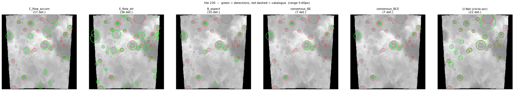

# Crater detection on lunar DEM tiles: classical terrain analysis vs. a U-Net

University project for a course on digital elevation models. The question: how far do
classical geomorphometric methods get at finding impact craters in a lunar DEM, and how
do they compare to a U-Net trained on the same data?

Five detectors are built from scratch on slope, relief, aspect and drainage, combined into
a consensus vote, and evaluated against the DeepMoon crater catalogue. The U-Net comes
from a companion project ([lunar-crater-detection](https://github.com/paulluap941/lunar-crater-detection))
and is used here for inference only, as a reference point.



*One tile from the dev set, scan range 5-60 px. Green = detections, red dashed = the
DeepMoon catalogue. Left to right: fill depth, D8 sinks, watershed with the aspect
filter, the two consensus variants, and the U-Net.*

Authors: Paul Schrepel, Khin San Wai

## Notebooks

Run them in this order.

| # | Notebook | What it does |
|---|---|---|
| 1 | `1_extract_best_tiles.ipynb` | Scans all 60 000 train + validation tiles, computes km/pixel per tile, and writes the 500 finest-resolution tiles with at least 5 catalogue craters to `data/best500_*.hdf5`. |
| 2 | `2_method_comparison.ipynb` | Develops the five methods step by step on those 500 tiles, with a figure for every intermediate stage, and compares them against a Sobel + Hough baseline. |
| 3 | `3_large_scale_evaluation.ipynb` | Applies the three best methods, both consensus variants and the U-Net to 2 000 random tiles from the full dev set (radius range 5–60 px). |
| 4 | `4_large_scale_evaluation_1_60.ipynb` | The same evaluation widened to 1–60 px, which covers 96 % of the catalogue instead of 25 %. Shows what happens once the very small craters are included. |

Each notebook is self-contained and carries its own copy of the shared helper functions,
so any one of them runs on its own.
If you change a method, change it everywhere.

## Methods

The function names use the lettering the methods were developed under:

| Function | Idea |
|---|---|
| `detect_baseline` | Sobel edges thresholded at a percentile, then a Hough circle transform. The naive approach, for reference. |
| `detect_A_slope` | Steep slopes as rim candidates, closed and shape-filtered, then a radius scan that requires both a steep rim and a deep interior. |
| `detect_B_watershed` | Sobel edge image flooded by watershed from `h_minima` markers; radius straight from segment area. |
| `detect_B_aspect` | Same, plus a filter requiring the segment's slope directions to point inward all the way round: a crater is a closed bowl, a two-sided valley is not. |
| `detect_C_flow_accum` | Detrended relief, hydrological sink filling (`topotoolbox`), threshold the fill depth, then the radius scan from method A. |
| `detect_E_flow_direction` | D8 flow directions; pixels lower than all eight neighbours are sinks, used as centres for the radius scan. |

The section headings inside `2_method_comparison.ipynb` run A–E in presentation
order instead, so its "Method B" heading sits above `detect_C_flow_accum`. The function
names are authoritative.

## Data

The DEM tiles and the crater catalogue are the DeepMoon supplemental dataset
([Zenodo record 1133969](https://zenodo.org/records/1133969), Silburt et al.,
*Lunar Crater Identification via Deep Learning*), derived from the LOLA/Kaguya merged
elevation model (60°N–60°S, 512 ppd). The files are about 30 GB in total and are not in
this repository.

Put them in `data/`:

```
data/train_images.hdf5   train_craters.hdf5
data/dev_images.hdf5     dev_craters.hdf5
data/test_images.hdf5    test_craters.hdf5
```

Tiles are 256×256 px with a resolution of 0.12 to 3.0 km/px (median 0.69), so a pixel
means something different from tile to tile, which is why `1_extract_best_tiles.ipynb`
selects the finest tiles for method development.

The U-Net weights (`crater_unet_best.pt`, 31 MB) are not in this repository either;
download them from the
[companion repo](https://github.com/paulluap941/lunar-crater-detection) into the project
root.

## Running it

```bash
pip install -r requirements.txt
jupyter lab
```

Python 3.12. A GPU is optional and only speeds up the U-Net inference step.

## How detections are scored

A detection counts as a hit if its centre is within `1.8 × min(r, r_true)` of a catalogue
crater and its radius is within a factor of two. Both the detections and the catalogue are
restricted to the scan radius range, so craters that were never in scope do not count
against recall, and detections outside it do not count against precision.

## Results

### Five methods on the 500 finest tiles

| Method | Precision | Recall | F1 |
|---|---|---|---|
| Baseline (Sobel + Hough) | 0.11 | 0.46 | 0.18 |
| A: slope + relief | 0.19 | 0.26 | 0.22 |
| B: watershed, no aspect filter | 0.22 | 0.63 | 0.33 |
| B: watershed + aspect filter | 0.42 | 0.60 | **0.50** |
| C: fill depth | 0.23 | 0.56 | 0.33 |
| E: D8 sinks | 0.42 | 0.61 | **0.50** |
| Consensus B + E | 0.57 | 0.53 | **0.55** |
| Consensus B + C + E | 0.60 | 0.49 | 0.54 |

### Radius bias

Every method measures craters too small, by 30–37 % on average:

| Method | mean ratio (catalogue / detected) | under-estimates by | n matched |
|---|---|---|---|
| Baseline | 1.43 | 30 % | 1 471 |
| A: slope | 1.53 | 35 % | 842 |
| B: watershed | 1.52 | 34 % | 2 041 |
| B: aspect | 1.55 | 35 % | 1 948 |
| C: fill depth | 1.53 | 35 % | 1 796 |
| E: D8 sinks | 1.59 | 37 % | 1 958 |

### Three methods on 2 000 random tiles

The 500 tiles above were the finest-resolution ones, chosen for developing the methods.
On 2 000 tiles drawn at random from the whole dev set, at the same 5–60 px scan range:

| Method | Precision | Recall | F1 |
|---|---|---|---|
| B: watershed + aspect filter | 0.36 | 0.37 | 0.36 |
| C: fill depth | 0.28 | 0.38 | 0.32 |
| E: D8 sinks | 0.28 | 0.59 | 0.38 |
| Consensus B + E | 0.50 | 0.32 | 0.39 |
| Consensus B + C + E | 0.60 | 0.34 | 0.43 |
| U-Net | **0.75** | **0.64** | **0.69** |

Applying the flat 1.5× radius correction from the bias section lifts every method:

| Method | Precision | Recall | F1 | F1 uncorrected |
|---|---|---|---|---|
| B: watershed + aspect filter | 0.37 | 0.54 | 0.44 | 0.36 |
| C: fill depth | 0.26 | 0.52 | 0.35 | 0.32 |
| E: D8 sinks | 0.31 | 0.64 | 0.41 | 0.38 |
| Consensus B + E | 0.52 | 0.50 | **0.51** | 0.39 |
| Consensus B + C + E | 0.58 | 0.44 | 0.50 | 0.43 |

The U-Net still leads at 0.69.

### The same evaluation widened to 1–60 px

The catalogue's median crater radius is 2.6 px, so the 5–60 px range covers only 25 %
of it. Widening the scan to 1–60 px covers 96 %:

| Method | Precision | Recall | F1 |
|---|---|---|---|
| B: watershed + aspect filter | 0.39 | 0.18 | 0.24 |
| C: fill depth | 0.22 | 0.16 | 0.18 |
| E: D8 sinks | 0.30 | 0.17 | 0.22 |
| Consensus B + E | 0.53 | 0.14 | 0.23 |
| Consensus B + C + E | 0.62 | 0.14 | 0.22 |
| U-Net | **0.83** | **0.46** | **0.59** |


### Conclusion
Precision holds up but recall is the problem, especially on small craters. On the craters that the terrain actually resolves, 5 to 60 px, the consensus comes within about three quarters of the U-Net (F1 0.51 against 0.69); below that size it is not competitive, 0.22 against 0.59. 
The U-Net stays ahead at every size, but only after a labelled training set and a training run; the classical pipeline is therefore a solid alternative, not a replacement.
